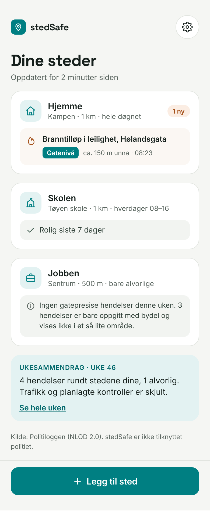
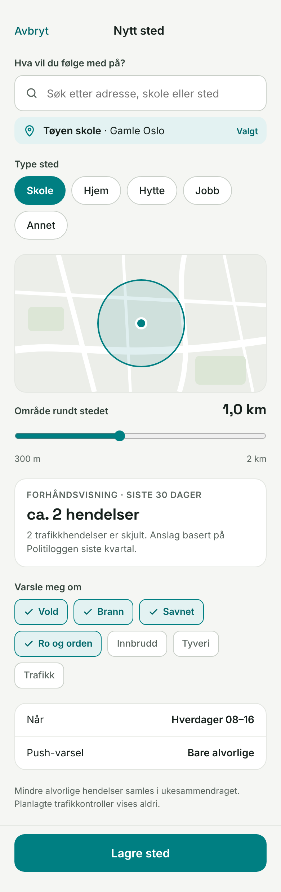
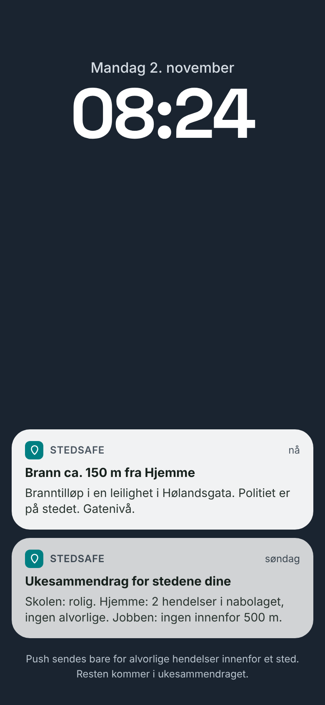
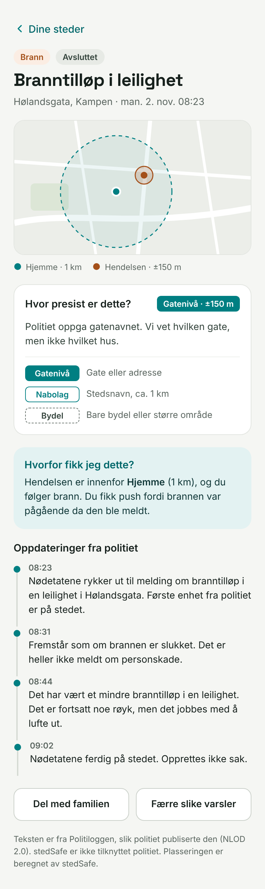

# stedSafe — Product brief, analysis & build specification

**Calm, place-based alerts from the Norwegian police log (Politiloggen)**
v0.1 · 11 November 2026 · working name «stedSafe» (not yet checked for trademark)

Bundle contents: this file · `screens/` (prototype screenshots + static HTML) · `research/presisjonstest.py` (v4 reference geocoder)

### What this document is

A complete rundown of the stedSafe idea written from the perspective of a product manager and startup advisor, and a build specification precise enough to hand to a coding agent. It consolidates the research, the precision test of the police-log data, the competitive scan and the chosen prototype design (direction A).

> **How to read it**
>
> **Sections 1–6** explain why and what: summary, problem, market, data findings, strategy, MVP scope.  
> **Sections 7–9** are the normative build spec. Words in capitals (MUST, SHOULD, MAY) are requirements.  
> **Sections 10–15** cover go-to-market, business model, risks, KPIs, roadmap and open questions.  
> **Appendices** hold reference data: full test tables, parsing rules, test fixtures, glossary, sources.  

> **For the coding agent: start here**
>
> - Read section 8 (Architecture) and section 9 (Geocoding & classification) first; they are the core.
> - The reference implementation of the geocoder is `research/presisjonstest.py` (v4). Port its logic; do not reinvent it. Appendix C lists fixtures it must pass.
> - Politiloggen field names are NOT officially documented. Inspect a live response before writing parsers and keep parsing defensive (section 8.3).
> - Never cache failed external lookups. Never push the same event twice to the same place.

## Contents

- [1. Executive summary](#1-executive-summary)
  - [Verdict](#verdict)
  - [What to build first](#what-to-build-first)
  - [Biggest risks](#biggest-risks)
  - [Next 6 weeks in one line](#next-6-weeks-in-one-line)
- [2. Problem & users](#2-problem--users)
  - [2.1 The problem](#21-the-problem)
  - [2.2 Target users](#22-target-users)
  - [2.3 What «good» looks like for the user](#23-what-good-looks-like-for-the-user)
- [3. Market & competition](#3-market--competition)
  - [3.1 Where stedSafe wins](#31-where-stedsafe-wins)
  - [3.2 Honest assessment](#32-honest-assessment)
- [4. Data foundation & precision analysis](#4-data-foundation--precision-analysis)
  - [4.1 Sources](#41-sources)
  - [4.2 Method](#42-method)
  - [4.3 Results (v4)](#43-results-v4)
  - [4.4 Manual review of street matches](#44-manual-review-of-street-matches)
  - [4.5 What cannot be placed (18 %)](#45-what-cannot-be-placed-18-)
  - [4.6 Product implications](#46-product-implications)
- [5. Product strategy](#5-product-strategy)
  - [5.1 Positioning](#51-positioning)
  - [5.2 Product principles](#52-product-principles)
  - [5.3 Explicit non-goals for the MVP](#53-explicit-non-goals-for-the-mvp)
- [6. MVP scope (product requirements)](#6-mvp-scope-product-requirements)
  - [6.1 Templates](#61-templates)
  - [6.2 Normative event rules](#62-normative-event-rules)
- [7. UX & design specification (direction A)](#7-ux--design-specification-direction-a)
  - [7.1 Design tokens](#71-design-tokens)
  - [7.2 Components](#72-components)
  - [7.3 Screens](#73-screens)
  - [7.4 Notification copy rules](#74-notification-copy-rules)
  - [7.5 Accessibility](#75-accessibility)
  - [7.6 Prototype screens (guidance only)](#76-prototype-screens-guidance-only)
- [8. Technical architecture](#8-technical-architecture)
  - [8.1 Stack](#81-stack)
  - [8.2 Components & data flow](#82-components--data-flow)
  - [8.3 Politiloggen ingestion](#83-politiloggen-ingestion)
  - [8.4 Database schema](#84-database-schema)
  - [8.5 Matching query](#85-matching-query)
  - [8.6 REST API (v1)](#86-rest-api-v1)
  - [8.7 Notifications](#87-notifications)
  - [8.8 Privacy & security](#88-privacy--security)
  - [8.9 Repository layout](#89-repository-layout)
- [9. Geocoding & classification specification](#9-geocoding--classification-specification)
  - [9.1 Pipeline](#91-pipeline)
  - [9.2 Place-name rules](#92-place-name-rules)
  - [9.3 Text parsing rules](#93-text-parsing-rules)
  - [9.4 External-call hygiene](#94-external-call-hygiene)
  - [9.5 Quality gates (CI)](#95-quality-gates-ci)
- [10. Go-to-market](#10-go-to-market)
- [11. Business model & costs](#11-business-model--costs)
- [12. Risks & mitigations](#12-risks--mitigations)
- [13. Success metrics](#13-success-metrics)
- [14. Roadmap & milestones](#14-roadmap--milestones)
- [15. Open questions](#15-open-questions)
- [Appendix A · Precision test details](#appendix-a--precision-test-details)
- [Appendix B · Category mapping & UI strings](#appendix-b--category-mapping--ui-strings)
- [Appendix C · Geocoder test fixtures](#appendix-c--geocoder-test-fixtures)
- [Appendix D · Glossary](#appendix-d--glossary)
- [Appendix E · Sources](#appendix-e--sources)

---

# 1. Executive summary

**stedSafe** turns the Norwegian police operations log (*Politiloggen*) into calm, precise alerts for the specific places a person cares about: a child's school, home, the cabin, the office. The official Politiloggen app only lets users follow a whole police district or municipality, which in Oslo means a steady stream of irrelevant traffic messages. Users have asked for map views and alerts near a location; the nearest independent competitor offers radius alerts but has a weak experience and is iOS-only.

| **63 %** | **28 %** | **~2 / day** | **0 kr** |
|---|---|---|---|
| of relevant Oslo incidents placeable within ~1 km | placeable within 500 m (street level) | non-traffic incidents in all of Oslo, so alerts per place are rare | data cost: Politiloggen and Kartverket are open (NLOD) |

## Verdict

**Worth building as a focused MVP.** The demand is visible, the data is free and good enough for *neighbourhood-level* alerts, and the competitive bar is low on experience. The idea is not defensible on data (anyone can call the same API), so the advantage must come from a better, calmer and more trustworthy product, speed of execution, and Android plus iOS from day one.

## What to build first

- Named places created from templates (Skole, Hjem, Hytte, Jobb, Annet), each with radius, categories and a time window.
- **1 km as the default radius**. Below 1 km, only street-level incidents count, and the app says so.
- Honest precision on every incident: *Gatenivå*, *Nabolag* or *Bydel*.
- Push **only** for serious incidents inside a place; everything else goes into a weekly digest.
- Planned traffic controls are filtered out; traffic is off by default for schools.
- Expo (iOS + Android), FastAPI, PostgreSQL + PostGIS, Expo Push. No user accounts.

## Biggest risks

- **Platform risk:** the police could add radius alerts to their own app, or change the unversioned API.
- **Precision ceiling:** about 1 in 4 incidents can be placed at street level; 18 % cannot be placed at all.
- **Fear dynamics:** crime-alert apps (e.g. Citizen) are criticised for creating anxiety. Calm design is a requirement, not a style choice.
- **Privacy:** a child's school plus a home location is sensitive. Data minimisation and easy deletion are mandatory.

## Next 6 weeks in one line

Interview 3–5 parents with the prototype while building the ingestion + geocoding backend; ship an internal build with push in week 4; closed beta with 20–30 Oslo users in week 6.

# 2. Problem & users

## 2.1 The problem

- Politiloggen is the police's primary channel for live incident information, but its app filters only by police district or municipality plus category. For Oslo that is far too coarse: a parent who cares about one school gets the whole city.
- Police messages carry no coordinates. Location is a free-text `area` field (e.g. «Grünerløkka», «E6 Furuset») plus street names inside the message text.
- Generic «crime near you» apps tend to maximise engagement through fear. People want awareness without anxiety.

## 2.2 Target users

| Segment | Job to be done | Priority |
|---|---|---|
| **Parents** (school, kindergarten, after-school) | «Tell me if something serious happens near my child's school during school hours, and nothing else.» | Primary |
| **Residents** (home, rental property) | «Let me know about break-ins, fires or violence in my neighbourhood.» | Primary |
| **Cabin owners** | «I'm not there. Tell me about break-ins and fires near the cabin.» | Secondary |
| **Commuters** | «Is something blocking my route today?» (needs road data; v2) | Later |
| **Home buyers** | «What has happened in this area over the past year?» (history view; v2) | Later |
| **Organisations** (FAU, housing co-ops, cabin associations) | Shared alerts for a school or estate (B2B; later) | Later |

## 2.3 What «good» looks like for the user

- Setting up a place takes under 30 seconds.
- Before saving, the user sees roughly how many alerts that place would have produced in the last 30 days.
- A push arrives within ~2 minutes of the police publishing, and only when it matters.
- Every incident says how precisely it is placed and why the user received it.
- A quiet week is reported as «Rolig», which is reassuring rather than empty.

# 3. Market & competition

*Snapshot from web research on 11 November 2026. Ratings and features change; re-check before launch.*

| Product | Area model | Alerts | Notes |
|---|---|---|---|
| **Politiloggen** (Politiet, official) | Police district or municipality + category | Push per district/municipality | Free, no login. App Store NO shows ~11k ratings, 4.7. Reviews ask for a map, «alerts only near my GPS position» and English. |
| **Politipuls** (independent, solo developer) | Map, municipality pages, radius per App Store listing; up to 20 municipalities | Push by district / municipality / radius | Web + iOS, launched May 2026, 5 ratings. Adds road data from Statens vegvesen. Founder test: no visible way to set own radius, weak UI/UX. No Android app found. |
| **Allemannsdata** | Place-name search incl. sub-areas | None (developer tool) | MCP server wrapping Politiloggen for AI agents. |
| **Politikontroller** | Location-based | Push near location | Crowdsourced police checks, 500k+ Norwegian drivers. Adjacent; proves demand for location-based police info. |
| **Poliskollen** (Sweden) | Region + incident type | Push | Map, AI assistant and gamification; Pro subscription. |
| **Brottsplatskartan** (Sweden) | Map + area | Home Assistant sensor | Shows enthusiasts automate area tracking. |
| **Nabohjælp** (Denmark) | Up to two addresses (e.g. home + summer house) | Neighbour warnings | ~290k users; piloting police burglary data in the app. |
| **Citizen / Ring Neighbors** (US) | GPS radius | Real-time push | Large, but widely criticised for creating a «culture of fear». |

## 3.1 Where stedSafe wins

| Dimension | Politiloggen | Politipuls | stedSafe (target) |
|---|---|---|---|
| Unit of interest | District / municipality | Municipality / radius | **Named places** with templates |
| Precision shown | No | Partly (location field) | **Always**, as Gatenivå / Nabolag / Bydel |
| Noise control | Category filter | Category filter | **Severity-gated push**, time windows, weekly digest, control filter |
| Platforms | iOS + Android | iOS (+ web) | **iOS + Android** |
| Tone | Neutral feed | Data/map | **Calm by design** |

## 3.2 Honest assessment

- «Radius alerts from Politiloggen» alone is no longer novel. Differentiation is **experience and trust**: templates, honest precision, calm notifications.
- No data moat. Defensibility comes from habit (places set up, digest read weekly), brand trust, and later from improved geocoding and multi-source coverage.
- The police adding a radius option is the main existential risk. Mitigation: be meaningfully better (multi-place, templates, digest, precision UX) and add sources the police app will not (roads, weather warnings).

# 4. Data foundation & precision analysis

## 4.1 Sources

| Source | Use | Access |
|---|---|---|
| Politiloggen API `api.politiloggen.politiet.no` | Incidents (threads of messages) | Open, NLOD 2.0, no key. Undocumented field names; format may change without notice. |
| Kartverket address API `ws.geonorge.no/adresser/v1` | Street → address points; exact addresses | Open, no key |
| Kartverket place-name API `ws.geonorge.no/stedsnavn/v1` | Area names → point + object type | Open, no key |
| Kartverket kommuneinfo API `ws.geonorge.no/kommuneinfo/v1` | Municipality name → number (needed outside Oslo) | Open, no key |

## 4.2 Method

A research script (`presisjonstest.py`, four iterations) fetched every Politiloggen thread in the API's `LastQuarter` window ending 11 Nov 2026, kept the 424 threads in Oslo municipality, and tried to place each incident with Kartverket data. Each placement gets an **uncertainty radius**: measured for streets (90th percentile distance from the centroid of the street's address points), fixed for exact addresses (25 m), computed from the gap between the two streets for crossings, and assumed per object type for place names. 28 planned traffic controls were identified and excluded, leaving **396 incidents**.

## 4.3 Results (v4)

| Placement method | Count | Share | Typical uncertainty |
|---|---|---|---|
| Exact address (street + house number) | 4 | 1 % | 25 m |
| Crossing of two streets | 12 | 3 % | 75–150 m |
| Street from area field | 24 | 6 % | measured per street |
| Street from message text | 77 | 19 % | measured per street |
| Long street limited to area | 14 | 4 % | ~500–900 m |
| Place name from area field | 195 | 49 % | assumed by type (mostly 1 km) |
| Municipality only (not placeable) | 70 | 18 % | n/a |

| Uncertainty ≤ | 300 m | 500 m | 1 000 m | 2 000 m |
|---|---|---|---|---|
| Share of 396 incidents | 21 % | 28 % | 63 % | 75 % |

| Category | Incidents | ≤ 500 m | ≤ 1 000 m |
|---|---|---|---|
| Trafikk | 195 | 23 % | 57 % |
| Brann | 66 | 44 % | 77 % |
| Voldshendelse | 42 | 31 % | 71 % |
| Ro og orden | 26 | 27 % | 54 % |
| Andre hendelser | 22 | 32 % | 64 % |
| Savnet | 21 | 5 % | 62 % |
| Tyveri | 10 | 50 % | 80 % |
| Others (Innbrudd, Ulykke, Skadeverk, …) | 14 | small samples | small samples |

## 4.4 Manual review of street matches

All 127 street-from-text matches from v3 were read by hand. The street name was right in roughly **95 %** of cases. The real problem was long streets: placing «Trondheimsveien 33» at the centroid of an 8 km road gave ±5.7 km. v4 fixed this with exact house numbers, crossings, and limiting long streets to the part near the area named in the area field. The ~6 genuine errors came from streets mentioned as a direction («avkjøringsrampen mot Maridalsveien»), multi-location announcements, and truncated names («Nedre Kalbakkvei» → «Kalbakkvei»); all are handled in v4.

## 4.5 What cannot be placed (18 %)

- No area field at all (16 incidents).
- Road-only messages: «E6», «Rv4», «E18 Bygdøylokket», «Ring 3 Økern» (~14). Better served by road data (Statens vegvesen DATEX II) later.
- Names spelled differently from the official register, e.g. «Majorstua» vs «Majorstuen», «Bryn», «Alfaset». Fixable with an alias table.
- Places outside Oslo municipality (Lysaker, Hosle in Bærum). Needs per-event municipality lookup.

> **Caveats**
>
> - The «≤ 1 km» figure depends on an assumption: 104 incidents placed on a *tettbebyggelse* name (e.g. Furuset) were given 1 000 m uncertainty. Real-world feedback should calibrate this.
> - One quarter, one municipality, one reviewer. Treat numbers as ±5 percentage points.

## 4.6 Product implications

- Promise neighbourhoods, not street corners: default radius 1 km; street level is a bonus.
- Small radii (< 1 km) MUST only count street-level incidents and MUST say so in the UI.
- Fire and violence, the categories parents care about most, are the best placed (≈ 70–77 % within 1 km).
- Volume is low: ~4.3 incidents/day in all of Oslo, ~2.2/day excluding traffic. A 1 km circle sees only a few per month. Design for quiet weeks.

# 5. Product strategy

## 5.1 Positioning

*For parents and residents who want to know when something serious happens near the places they care about, stedSafe is a calm alert app that turns the police log into precise, place-based notifications. Unlike the official Politiloggen app, it follows named places instead of whole municipalities, says honestly how precise each incident is, and only interrupts you when it matters.*

## 5.2 Product principles

| Principle | What it means in practice |
|---|---|
| **Calm by default** | Push only for serious incidents; digest for the rest; «Rolig» is a first-class state; no red sirens, no counters that reward checking. |
| **Honest precision** | Every incident carries a precision tier and uncertainty. Never draw a precise pin for an imprecise location. |
| **Place first** | The home screen is a list of the user's places with status, not a city-wide feed. |
| **Source-faithful** | Show police text as published, with time stamps and NLOD attribution. Never rewrite facts. |
| **Privacy by design** | No accounts, minimal data, one-tap delete, no names of children, no tracking SDKs. |
| **No crowd content** | No comments, user reports or person descriptions, which avoids the profiling problems seen in Neighbors-style apps. |

## 5.3 Explicit non-goals for the MVP

- No user accounts, social features or comments.
- No live GPS «near me» tracking: places are fixed points, chosen by the user.
- No incident data from other sources (roads, weather, transit) yet; the architecture must allow it.
- No monetisation in v1.

# 6. MVP scope (product requirements)

Platforms: iOS and Android via Expo. UI language: Norwegian Bokmål. Launch market: Oslo (the pipeline MUST handle any municipality; marketing starts in Oslo).

| ID | Feature | Pri. | Acceptance criteria |
|---|---|---|---|
| F1 | Create / edit / delete place | P0 | Search address or place (Kartverket), or drop a pin; choose template; label ≤ 40 chars; save in < 30 s; delete removes it server-side immediately. |
| F2 | Templates | P0 | Selecting a template sets categories and time window (table 6.1). User can override. |
| F3 | Radius + preview | P0 | Slider 300–2 000 m, step 100, default 1 000. Shows real count of matching incidents in last 30 days, hidden-traffic count, and the small-radius note when < 1 000 m. |
| F4 | Home overview | P0 | One card per place: label, template, radius, window, status («Rolig siste 7 dager» or «N ny»), newest incident with precision badge and distance. |
| F5 | Incident detail | P0 | Map with place circle + incident point/uncertainty ring; category; status; precision tier + explanation; «Hvorfor fikk jeg dette?»; all police updates with times; source line. |
| F6 | Push alerts | P0 | Only when rules in 6.2 say so; delivered ≤ 2 min after ingestion; tapping opens F5; never twice for the same place + incident. |
| F7 | Weekly digest | P1 | Sunday 18:00 Europe/Oslo push + in-app view: per place counts, severe count, imprecise-nearby count; sent even in quiet weeks. |
| F8 | Noise filters | P0 | Planned traffic controls never shown; «Trafikk» off by default for Skole/Hjem/Hytte/Jobb. |
| F9 | Settings & privacy | P0 | Toggle push; delete all data; privacy policy; source & licence screen. |
| F10 | «Feil plassering?» feedback | P1 | One tap on F5 logs event id + place id; used to tune the geocoder. |
| F11 | Family sharing, commuter routes, SEO pages, extra sources | P2 | Out of MVP; keep schema extensible. |

## 6.1 Templates

| Template | Default categories | Push time window |
|---|---|---|
| Skole | Vold, Brann, Savnet, Ro og orden | Weekdays 08:00–16:00 |
| Hjem | Innbrudd, Brann, Vold, Ro og orden | All day |
| Hytte | Innbrudd, Brann | All day |
| Jobb | Vold, Brann | Weekdays 07:00–17:00 |
| Annet | All except Trafikk | All day |

## 6.2 Normative event rules

**Precision tier** from uncertainty `u` (metres): **gate** if u ≤ 500 · **nabolag** if 500 < u ≤ 1 500 · **bydel** if u > 1 500 or no point. `u` is rounded half-up to whole metres before it is stored, and the tier is computed from the stored integer (decided 2026-11-12).

**Match** (incident counts for a place) when ALL hold:

1. Incident category is in the place's categories and the incident is not a planned control.
2. distance(place.center, incident.point) ≤ place.radius.
3. Tier is **gate** when radius < 1 000 m; tier is **gate** or **nabolag** when radius ≥ 1 000 m.

**Imprecise nearby** (digest only, never push): tier **bydel** and the uncertainty circle overlaps the place circle, i.e. distance ≤ radius + u.

**Push** when the incident matches AND is **severe** AND the first police message is ≤ 30 min old at detection AND the first message time is inside the place's time window AND the place has fewer than 3 pushes today. Otherwise it goes to the digest. Updates to a thread never re-push.

**Severe** (v1 heuristic, tune in beta): category in {Brann, Voldshendelse, Savnet, Redning, Ulykke} OR text contains any of: `kniv, skudd, skyt, våpen, eksplosjon, evakuer, ran, trusselsituasjon, gissel`. Category Trafikk is severe only if the text contains `alvorlig skadd, omkommet, påkjørt barn`. Both keyword lists match case-insensitively at the start of a word, so stems work («skyt» → skyting) but «ran» does not match inside «brannvesenet» (decided 2026-11-12).

# 7. UX & design specification (direction A)

The chosen direction is **A: soft cards**, with deep teal as the accent. The interactive prototype (private to the founder) lives at `claude.ai/artifact/DGFiKYVJU8We7ut2o3zhLW`. Direction B («Loggbok») is parked; the notification copy rules from B are adopted here.

## 7.1 Design tokens

| Token | Value | Use |
|---|---|---|
| color.bg | `#F5F6F3` | App background |
| color.surface | `#FFFFFF` | Cards |
| color.border / border.strong | `#E2E5E0 / #C9CFC8` | Card borders / inputs, unselected chips |
| color.ink / ink2 / muted | `#16201C / #33433B / #5B6660` | Text levels (muted passes 4.5:1 on bg) |
| color.accent | `#007F82` | Primary buttons, selected chips, Gatenivå badge, map circles |
| color.accentStrong | `#00676A` | Accent-coloured TEXT on tints and links (5.9:1 on tint) |
| color.accentTint | `#E3F2F2` | «Hvorfor…» box, digest card, selected category chips |
| color.severe / severeTint | `#A4501A / #FBEDE3` | Severe category label and «N ny» badge only |
| color.calmTint | `#F2F4F1` | «Rolig» status rows |
| radius | `card 18 · inner 12 · button 14 · badge 6 · chip 999` |  |
| spacing | `screen 20 · card padding 16 · stack gap 16 / 12` |  |
| font.body | `Inter 400/500/600/700` | Body, labels |
| font.display | `Space Grotesk 600/700` | Screen titles, big numbers |

## 7.2 Components

| Component | Spec |
|---|---|
| PlaceCard | Icon tile 40×40 (accentTint bg, accent stroke icon) · label 16/600 · meta 13 muted «Kampen · 1 km · hele døgnet» · optional «N ny» severe badge · status row (calm or incident row). |
| IncidentRow | Category icon · title 14/600 · PrecisionBadge · «ca. 150 m unna · 08:23». Severe incidents use severeTint background. |
| PrecisionBadge | **Gatenivå**: filled accent, white text · **Nabolag**: white with 1.5 px accent outline, accent text · **Bydel**: white with 1.5 px dashed grey outline. Differ by shape/fill, not only colour. |
| TypeChip / CategoryChip | ≥ 40 px tall; selected = accent fill (type) or accentTint + check (category); aria-pressed / accessibilityState.selected. |
| RadiusSlider | 300–2 000 m, step 100; live label «1,0 km» / «700 m»; map circle updates live. |
| InfoNote | Dashed 1 px border, info icon, 13 px text. Used for the small-radius warning. |
| PrimaryButton | Height 52, radius 14, accent fill, white 16/600 text; pinned to bottom bar. |

## 7.3 Screens

| Screen | Content (top to bottom) |
|---|---|
| Hjem («Dine steder») | Logo row + settings · title «Dine steder» + «Oppdatert for N minutter siden» · PlaceCards · digest card «Ukesammendrag · uke N» · source line · bottom button «Legg til sted». |
| Nytt sted | «Avbryt» · search input + selected result · type chips · map with live radius circle · radius slider + label · small-radius InfoNote · preview card («Forhåndsvisning · siste 30 dager», count, hidden traffic) · category chips · «Når» / «Push-varsel» rows · bottom «Lagre sted». |
| Hendelse | Back «Dine steder» · category + status chips · title · «gate, område · dato tid» · map (place circle dashed + incident ring) · legend · «Hvor presist er dette?» card with badge, explanation, 3-tier legend · «Hvorfor fikk jeg dette?» · timeline «Oppdateringer fra politiet» · actions «Del med familien», «Færre slike varsler» · source line. |
| Push (OS-rendered) | The OS draws notifications. Only title/body text is ours. See 7.4. The prototype's custom-styled lock screen is illustrative only. |

## 7.4 Notification copy rules

- Title = what + distance + place: «Brann ca. 150 m fra Hjemme».
- Body = where + status + precision: «Hølandsgata, Kampen. Branntilløp i leilighet, nødetatene er på stedet. Presisjon: gate.»
- Never include names, ages, ethnicity or descriptions of people, even if the police text does. Max two lines.
- Digest title: «Uke 46: rolig ved Skolen» or «Uke 46: 4 hendelser rundt stedene dine».

## 7.5 Accessibility

- Contrast: white on #007F82 = 4.8:1 (pass); #00676A on #E3F2F2 = 5.9:1 (pass). Never put #007F82 text on the tint (4.3:1, fails).
- Touch targets ≥ 44 px. Every icon-only button has an accessibilityLabel.
- Precision and severity are never conveyed by colour alone (badge shape + text label).
- Support Dynamic Type / font scaling; cards grow, nothing truncates critical text.

## 7.6 Prototype screens (guidance only)

These are the four screens from the clickable prototype (direction A, deep teal). They show **intent**: hierarchy, tone, copy and the precision badges. They are **not** pixel specs. Where a screen and the written spec disagree, **the written spec wins** (tokens in 7.1, components in 7.2, rules in 6.2 and 7.4).

Static HTML versions of each screen are in `screens/html/`. Open them in a browser or read the inline styles for exact values (colours, sizes, spacing). Fonts: Inter (body) and Space Grotesk (headings).

Images below are full-length (scrolled content included). Versions cropped to one phone screen (390×844) are in `screens/` without the `-full` suffix.

| Hjem («Dine steder») | Nytt sted |
|---|---|
|  |  |

| Varsel (illustrative) | Hendelse |
|---|---|
|  |  |

**Notes per screen**

- **Hjem:** one card per place with status first. The *Jobben* card (500 m) shows how the app explains that district-level incidents are left out of small areas. The weekly digest card sits under the places; «Legg til sted» is pinned to the bottom.
- **Nytt sted:** shown in its default state (template *Skole*, radius 1 km). In the prototype the type chips, radius slider and category chips are interactive. The preview number there is a rough estimate; in the product it MUST come from `GET /v1/preview` (real counts for the last 30 days).
- **Varsel:** illustrative only. iOS and Android draw notifications themselves; the app controls only title and body text (rules in 7.4). Do not try to style notifications.
- **Hendelse:** map with the place circle (dashed) and the incident with its uncertainty ring. Then the precision card with the three-tier legend, «Hvorfor fikk jeg dette?», and the police updates with times. The incident is a real Politiloggen thread from the test data; the update times are invented for the mock.
- **Demo data:** place names, counts and times in all screens are sample data. Never hard-code them.

# 8. Technical architecture

## 8.1 Stack

| Layer | Choice | Why |
|---|---|---|
| Mobile | Expo (React Native, TypeScript), expo-router, react-native-maps, expo-notifications | One codebase for iOS + Android; Expo Push is free |
| API | FastAPI (Python 3.12), Pydantic v2, SQLAlchemy 2 / asyncpg | Matches founder's stack; geocoder is already Python |
| Database | PostgreSQL 17 + PostGIS (decided 2026-11-12: 17 instead of 16, because Homebrew's PostGIS is not built for 16) | Geography types, ST_DWithin, GiST indexes |
| Worker | Separate process (same codebase) with an asyncio loop / APScheduler | Polling, geocoding, matching, push, digest |
| Hosting | Render (web service + background worker + managed Postgres) | Founder already uses it; low ops |
| Push | Expo Push API (+ receipts) | Handles APNs/FCM |

## 8.2 Components & data flow

```text
 Politiloggen API ──(poll 60 s)──► INGESTOR ──► events / event_messages (upsert)
                                       │
                                       ▼
                                  GEOCODER ──► Kartverket address / place-name APIs (cached)
                                       │        point + uncertainty_m + tier + method
                                       ▼
                                 CLASSIFIER ──► is_control, severity
                                       │
                                       ▼
                                   MATCHER ──► places (PostGIS ST_DWithin + tier rules)
                                       │
                                       ▼
                                  NOTIFIER ──► Expo Push (immediate) · digest (Sun 18:00)
 Mobile app ◄────── REST API (FastAPI) ◄────── same database
```

## 8.3 Politiloggen ingestion

```http
GET https://api.politiloggen.politiet.no/messagethreads
    ?take=100&skip=0&sortByEnum=LastMessageOn&timeSpanType=<see note>
Accept: application/json
→ { "messageThreads": [ ... ], "hasMoreResults": true|false }
```

- Field names inside a thread are NOT officially documented. Observed/expected: id, district, municipality, area, category, created/last-message timestamps, active flag, and a list of messages with text and timestamps. The agent MUST fetch a live sample first (the research script has `--sample`), then write a typed adapter with defensive, case-insensitive field lookup (see `pick()` in the reference script).
- Only `timeSpanType=LastQuarter` is verified. Check the API's Swagger for smaller windows; use the smallest that covers the poll interval with margin.
  - (decided 2026-11-12) The Swagger spec (`/swagger/v1/swagger.json`) lists `None, Custom, LastHour, LastDay, LastWeek, LastMonth, LastQuarter, LastYear`. `LastHour` and `LastDay` filter on the thread's last message time. `Custom` needs both `DateTimeFrom` and `DateTimeTo`. `Take` may be up to 1000. The poller uses `LastDay`: about 130 threads nationwide, one page. While the last successful poll is more than 23 h old, it uses `LastQuarter` instead, so an outage is caught up.
- Sort order is not globally reliable. Each cycle MUST read at least 3 pages (300 threads) and paginate by `skip += len(page)`. After the first 3 pages, continue only while a page still contains threads whose last message is newer than the last successful poll minus a safety margin of 15 minutes; always stop at `hasMoreResults=false` or an empty page (decided 2026-11-12).
- Message identity (decided 2026-11-12): a message id is `<threadId>-<n>`, and `n` is stored as `event_messages.seq`. Gaps in `n` are normal (removed messages). Messages are upserted by `(event_id, seq)`, so an «Edited» message (type `Edited`) replaces its text. Messages of type `Draft` or `Removed`, and messages whose id does not match the pattern, are skipped (the latter with a WARN).
- Upsert by thread id. New thread → geocode → classify → match → notify. Updated thread → store new messages; re-geocode if the area changed, there is no point yet, or the tier is still **bydel** or **nabolag** (so a later message with an address can improve the placement); never re-push (decided 2026-11-12).
- An event's first message time (`first_message_at`) is the earliest message timestamp in the thread; fall back to the thread-level created field only if messages have no timestamps (decided 2026-11-12).
- Handle 429/5xx with exponential backoff (1, 2, 4, 8, 16 s). Alert (log at ERROR) if no successful poll for 10 min.
- Map the event's municipality name to a kommunenummer (kommuneinfo API, cached) and geocode within that municipality.
  - (decided 2026-11-12) Both the Norwegian and the Sámi names are matched, ignoring case. Names that don't resolve are skipped with one WARN per name: police districts in the municipality field («Oslo politidistrikt»), qualified names («Våler (Øst)», «Herøy (Nordland)») and «Kvam Herad». None of them are in Oslo or Akershus. Only threads in the allowed fylker are stored.
- Attribution: «Kilde: Politiloggen (NLOD 2.0)» on every screen showing police text.

## 8.4 Database schema

```sql
CREATE EXTENSION IF NOT EXISTS postgis;

CREATE TABLE events (
  id               TEXT PRIMARY KEY,           -- Politiloggen thread id
  district         TEXT,
  municipality     TEXT,
  kommunenummer    TEXT,
  area             TEXT,
  category         TEXT NOT NULL,
  is_control       BOOLEAN NOT NULL DEFAULT false,
  severity         TEXT NOT NULL CHECK (severity IN ('severe','normal')),
  first_message_at TIMESTAMPTZ NOT NULL,
  last_message_at  TIMESTAMPTZ NOT NULL,
  is_active        BOOLEAN,
  geom             GEOGRAPHY(Point, 4326),
  uncertainty_m    INTEGER,
  precision_tier   TEXT CHECK (precision_tier IN ('gate','nabolag','bydel')),
  geocode_method   TEXT,   -- adresse|kryss|gate_area|gate_tekst|gate_omrade|stedsnavn|kommune
  geocode_match    TEXT,
  raw              JSONB NOT NULL,
  updated_at       TIMESTAMPTZ NOT NULL DEFAULT now()
);
CREATE INDEX events_geom_gix  ON events USING GIST (geom);
CREATE INDEX events_first_idx ON events (first_message_at DESC);

CREATE TABLE event_messages (
  event_id   TEXT REFERENCES events(id) ON DELETE CASCADE,
  seq        INTEGER NOT NULL,
  created_at TIMESTAMPTZ NOT NULL,
  text       TEXT NOT NULL,
  PRIMARY KEY (event_id, seq)
);
```

```sql
CREATE TABLE devices (
  id           UUID PRIMARY KEY,
  secret_hash  TEXT NOT NULL,          -- bearer secret, hashed
  push_token   TEXT,
  platform     TEXT CHECK (platform IN ('ios','android')),
  tz           TEXT NOT NULL DEFAULT 'Europe/Oslo',
  created_at   TIMESTAMPTZ NOT NULL DEFAULT now(),
  last_seen_at TIMESTAMPTZ
);

CREATE TABLE places (
  id          UUID PRIMARY KEY,
  device_id   UUID NOT NULL REFERENCES devices(id) ON DELETE CASCADE,
  label       TEXT NOT NULL CHECK (char_length(label) <= 40),
  template    TEXT NOT NULL CHECK (template IN ('skole','hjem','hytte','jobb','annet')),
  center      GEOGRAPHY(Point, 4326) NOT NULL,
  radius_m    INTEGER NOT NULL CHECK (radius_m BETWEEN 300 AND 2000),
  categories  TEXT[] NOT NULL,  -- app categories (Appendix B), not police categories (decided 2026-11-12)
  time_window JSONB NOT NULL,   -- {"days":[1,2,3,4,5],"from":"08:00","to":"16:00"} | {"all":true}
  push        BOOLEAN NOT NULL DEFAULT true,
  created_at  TIMESTAMPTZ NOT NULL DEFAULT now()
);
CREATE INDEX places_center_gix ON places USING GIST (center);

CREATE TABLE notifications (
  id         BIGSERIAL PRIMARY KEY,
  place_id   UUID REFERENCES places(id) ON DELETE CASCADE,
  event_id   TEXT REFERENCES events(id) ON DELETE CASCADE,
  kind       TEXT NOT NULL CHECK (kind IN ('push','digest')),
  sent_at    TIMESTAMPTZ NOT NULL DEFAULT now(),
  ticket_id  TEXT,
  status     TEXT,
  UNIQUE (place_id, event_id, kind)       -- guarantees no duplicate pushes
);

CREATE TABLE geocode_cache (
  key TEXT PRIMARY KEY, value JSONB, fetched_at TIMESTAMPTZ DEFAULT now()
);
CREATE TABLE placement_feedback (
  event_id TEXT, place_id UUID, created_at TIMESTAMPTZ DEFAULT now()
);

-- Poll status for the 10-minute alarm and GET /v1/health (decided 2026-11-12)
CREATE TABLE ingest_state (
  id              BOOLEAN PRIMARY KEY DEFAULT true CHECK (id),   -- single row
  last_success_at TIMESTAMPTZ,
  last_error_at   TIMESTAMPTZ,
  last_error      TEXT
);
```

## 8.5 Matching query

```sql
-- places that should consider a new event :e
SELECT p.*
FROM places p
WHERE :e_category = ANY (p.categories)
  AND NOT :e_is_control
  AND ST_DWithin(p.center, :e_geom, p.radius_m)
  AND (:e_tier = 'gate' OR (:e_tier = 'nabolag' AND p.radius_m >= 1000));
```

`places.categories` holds app categories (Appendix B), so the matcher expands them to police categories before the `:e_category` comparison above, using one backend module that holds the Appendix B mapping (decided 2026-11-12).

## 8.6 REST API (v1)

| Method & path | Purpose |
|---|---|
| `POST /v1/devices` | Register anonymous device → {device_id, secret}. All other calls: Authorization: Bearer secret. |
| `PUT /v1/devices/me` | Update push_token, platform, tz. |
| `DELETE /v1/devices/me` | Delete device, places, notifications (GDPR erase). |
| `GET /v1/geocode/search?q=` | Proxy to Kartverket address + place-name search (cached, rate-limited). |
| `GET /v1/preview?lat&lon&radius_m&categories` | Counts for the last 30 days: matched, severe, hidden_traffic, imprecise_nearby. Replaces the prototype's estimate. |
| `GET/POST /v1/places · PATCH/DELETE /v1/places/{id}` | CRUD for places. |
| `GET /v1/places/{id}/events?days=30` | Matched + imprecise-nearby events with distance and tier. |
| `GET /v1/events/{id}` | Event with all messages, point, uncertainty, tier, method. |
| `POST /v1/events/{id}/feedback` | «Feil plassering?» (body: place_id). |
| `GET /v1/health` | Liveness + last successful poll time. |

## 8.7 Notifications

- Insert into `notifications` BEFORE sending; the unique constraint prevents duplicates across worker restarts.
- Send via Expo Push in batches of ≤ 100; poll receipts after 15 min; null the token on DeviceNotRegistered.
- Payload data: {event_id, place_id}. Deep link opens the incident detail.
- Digest job: Sundays 18:00 in the device's tz. Per place: matched (7 days), severe, imprecise_nearby. Always send, even if zero («Rolig uke»).

## 8.8 Privacy & security

- No accounts, no email, no analytics SDK that tracks individuals. Aggregate, anonymous usage counts only.
- Store the minimum: place center, radius, categories, user-chosen label. Advise in the UI: do not use children's names in labels.
- Device secret stored hashed; HTTPS only; rate limit per device.
- One-tap delete (DELETE /v1/devices/me). Retain events (public data) for 13 months; delete inactive devices after 12 months.
- Privacy policy MUST explain that place locations are processed to send alerts (legal basis: consent). v2: evaluate on-device matching so the server never sees places.

## 8.9 Repository layout

The repository root (currently named `Kring`) is the `stedsafe/` level below (decided 2026-11-12).

```text
stedsafe/
  backend/
    app/  api/  ingest/  geocode/  classify/  match/  notify/  digest/  db/  settings.py
    tests/  fixtures/politiloggen/  fixtures/kartverket/  test_geocode_golden.py
    alembic/
  mobile/   (Expo, TypeScript, expo-router)
    app/(tabs)/index.tsx  app/place/new.tsx  app/event/[id].tsx  components/  theme/tokens.ts
  research/presisjonstest.py      # v4 reference implementation
  docs/stedSafe-spec.pdf
```

# 9. Geocoding & classification specification

Port the v4 logic of `presisjonstest.py`. Order is significant: the first step that succeeds wins, except for rule 9.4 which can downgrade a street to the area.

Where this section and `presisjonstest.py` disagree (for example the type and uncertainty tables in 9.2), the script is the source of truth; the tables here are a summary (decided 2026-11-12).

## 9.1 Pipeline

1. **Exact address.** For each street candidate (area field first, then text), look for a house number directly after it (`Trondheimsveien 33`, `Steenstrups gate 1b`). Ignore numbers followed by «etasje», «km», «kmt», «personer», «biler», «år». Look up with `adressenavn, nummer, bokstav, kommunenummer`. Uncertainty 25 m.
2. **Crossing.** Detect «A/B», «A x B», «krysset A og B». Fetch all address points of both streets; take the closest pair; reject if they are > 250 m apart. Uncertainty = max(75, d/2 + 50).
3. **Street.** Candidates from the area field (whole part first, e.g. «Nedre Kalbakkvei»), then from text with the direction filter (9.3). Point = centroid of the street's address points; uncertainty = 90th percentile distance to that centroid (min 50 m).
4. **Long street + area.** If street uncertainty > 1 000 m and the area field resolves to a place name, keep only address points within max(area uncertainty, 800 m) of that place; recompute (min 2 points).
5. **Downgrade.** If the street result is still less precise than the area place name, use the place name.
6. **Place name.** Area parts → place-name API (exact spelling match, prefer area types, see 9.2).
7. **Municipality only.** No point; tier = bydel; never pushed.

## 9.2 Place-name rules

- Endpoint `GET ws.geonorge.no/stedsnavn/v1/navn?sok=…&knr=…&utkoordsys=4258&fuzzy=false`. The municipality filter is `knr` (not `kommunenummer`); the path is `/navn` (not `/sok`).
- Response: `navn[].stedsnavn[].skrivemåte`, `navn[].navneobjekttype`, `navn[].representasjonspunkt.{øst,nord}`.
- When several objects share the name, prefer by type: administrativ bydel / bydel → tettbebyggelse / tettsteddel → boligfelt → grend → tettsted → industriområde → senter → torg → park → gard → stations → **holdeplass (last)**. «Furuset» in the police log means the area, not the bus stop.
- If the chosen type is «adressenavn», geocode as a street instead.
- Split the area field on «,», «/», «;», « - », « V/ », « ved »; strip road prefixes (E6, Rv. 4, Fv, Ring 3).
- Aliases (police terms that are not official names): «Sentrum», «Oslo sentrum» → 59.9133, 10.7389, 1 200 m; «Oslo S» → 59.9110, 10.7522, 300 m; «Rosenhoff» → 59.93098, 10.77447 (the point of «Rosenhoff skole» in the place-name register, which has no area called Rosenhoff), 800 m (decided 2026-11-12). Add «Majorstua» → «Majorstuen» etc. as found.

| Object type | Assumed uncertainty | Object type | Assumed uncertainty |
|---|---|---|---|
| administrativ bydel / bydel | 2 500 m | gard (Oslo farm names = neighbourhoods) | 700 m |
| tettsted | 2 500 m | industriområde | 600 m |
| tettsteddel | 1 200 m | boligfelt | 500 m |
| tettbebyggelse | 1 000 m | park | 400 m |
| grend | 800 m | stasjon / t-banestasjon | 300 m |
| (default) | 1 500 m | holdeplass / skole | 200 m |
|  |  | torg / bru / vegkryss | 150 m |

## 9.3 Text parsing rules

- Street suffixes (joined): veien, vegen, veg, vei, gata, gaten, gate, plassen, torget, bakken, stien, bryggen, kaia, ringen, svingen, tunnelen, alléen, hellinga. Separate-word suffixes: gate, gata, vei, veg, plass, torg, allé, bakke, brygge, kai.
- Include up to two capitalised words before a joined name (Økern Torgvei, Nedre Kalbakkvei); generate candidates longest first; drop leading stop-words (I, På, Ved, Mot, Vi, Politiet, Nødetatene, Krysset, …).
- Variants: «-gata/-gaten» → «-gate»; «Hausmannsgate» → «Hausmanns gate».
- Direction filter: skip a street if the preceding 40 chars end with «mot», «retning», «avkjøring(en) mot/til», «kjørte (videre) mot/til», «løp mot», «forsvant (i retning)».
- Planned control: category Trafikk AND text matches trafikkontroll, fartskontroll, laserkontroll, hastighetskontroll, ruskontroll, «aksjon skolevei» or «trafikkorpset har avholdt».

## 9.4 External-call hygiene

- Cache every successful lookup (including genuine «not found» = HTTP 200 with no hits or 400/404) in `geocode_cache`.
- NEVER cache 429, 5xx, timeouts or connection errors; retry on the next cycle.
- Space calls ≥ 150 ms; exponential backoff on 429. A failed Kartverket call is retried at most twice within the same lookup (after 1 s and 2 s), then given up without caching (decided 2026-11-12).
- Fetch up to 1 000 address points per street (treffPerSide=1000) so crossings and area-limiting work.

## 9.5 Quality gates (CI)

- All fixtures in Appendix C pass.
- Replay of a recorded Oslo quarter: ≥ 60 % of non-control incidents with uncertainty ≤ 1 000 m and ≥ 25 % ≤ 500 m. The gate is Oslo-only; Akershus is reported but not gated (decided 2026-11-12).
- Manual sample of 25 street-based placements: ≥ 90 % correct street (tracked per release).

# 10. Go-to-market

- **Launch area:** Oslo, where incident density makes the value obvious. Expand to Akershus municipalities next (Lørenskog, Bærum, Asker).
- **Channels:** FAU (parents' councils) and class groups, neighbourhood Facebook groups, housing co-op boards, local media story about «calm alerts». One parent sharing reaches a whole class.
- **ASO:** «politilogg», «politiloggen varsel», «varsel nabolag», «skole trygghet». Do not use «politi» in the app name or icon.
- **SEO (v2):** public pages per bydel with recent incidents and a calm area summary, linking to the app.
- **Message:** «Rolig oversikt over det som skjer rundt stedene dine.» Never market with fear.

# 11. Business model & costs

- **v1: free.** Goal is habit and trust.
- **Later premium (don't remove anything free):** more than 3 places, family sharing, 12-month history, route alerts.
- **Later B2B:** FAU/schools, housing co-ops, cabin associations, property managers, estate agents (area history).
- **Running costs:** Render web + worker + managed Postgres on starter tiers (check current pricing); Expo Push, Politiloggen and Kartverket are free. No LLM needed for v1.

# 12. Risks & mitigations

| Risk | Likelihood / impact | Mitigation |
|---|---|---|
| Police add radius/place alerts to Politiloggen | Medium / High | Differentiate on templates, digest, precision UX, multi-source; move fast. |
| API changes or outages (unversioned; outages reported in 2025) | Medium / High | Defensive parsing, contract tests on recorded payloads, health alarms, status banner in app. |
| Wrong placement causes alarm or misses | Medium / Medium | Precision tiers, conservative push rules, «Feil plassering?» feedback loop. |
| App increases anxiety | Medium / High | Push only severe, quiet-week messaging, no fear marketing, user-controlled categories. |
| Privacy breach of place data | Low / High | Minimal data, hashed secrets, deletion, no third-party trackers; v2 on-device matching. |
| Legal/brand: impersonating police, NLOD attribution | Low / Medium | No police logos or «politi» in name; clear «not affiliated» text; attribution on every screen. |
| Competitor (Politipuls) improves fast | Medium / Medium | Ship Android + better UX first; build habit via digest. |
| Solo-founder capacity | High / Medium | Strict MVP scope; reuse existing stack; automate tests. |

# 13. Success metrics

| Metric | Target (beta) | Why |
|---|---|---|
| Activation: place created in first session | ≥ 70 % | Setup is the core value moment |
| Pushes per active user per week (median) | 0.5–2 | Calm by design; above 3 signals noise |
| Push opt-out within 30 days | < 10 % | Trust in alert relevance |
| Digest open rate | ≥ 30 % | Weekly habit |
| D30 retention | ≥ 35 % | Product–market fit signal |
| «Feil plassering?» rate on opened incidents | < 5 % | Geocoder quality |
| Ingestion lag (publish → push), p95 | ≤ 2 min | Timeliness |

# 14. Roadmap & milestones

| Milestone | Scope | Definition of done |
|---|---|---|
| M0 · week 0–1 | Parent interviews (3–5) with the prototype · backend spike: ingest + geocode + DB | Live Oslo ingestion running; Appendix C fixtures green; interview notes summarised. Ingestion covers Oslo + Akershus and runs locally; the Render deploy moves to M1 (decided 2026-11-12). |
| M1 · week 2–4 | API, matching, push, Expo screens Hjem / Nytt sted / Hendelse | Internal build (TestFlight + Play internal); push ≤ 2 min end-to-end. |
| M2 · week 5–6 | Digest, settings, delete, privacy policy, store listings | Closed beta with 20–30 Oslo users. |
| M3 · week 7–10 | Iterate on metrics; aliases; Akershus municipalities; feedback loop | Metrics in section 13 met or explained. |
| Later | Family sharing, commuter routes (Vegvesen DATEX II, Entur), MET weather warnings, SEO pages, B2B | Prioritise from beta learnings. |

# 15. Open questions

1. ~~Exact Politiloggen field names and the allowed values of `timeSpanType` (check Swagger).~~ Answered in §8.3 (decided 2026-11-12). Field names are still read defensively.
2. Is 60-second polling acceptable to the police? No documented rate limit; consider contacting the API owner.
3. Severity heuristics: validate with real beta data and user feedback.
4. Should «bydel»-precision incidents be shown at all outside the digest?
5. Legal review of storing place locations (consent wording, DPIA-light).
6. Name: is «stedSafe» available (trademark, App Store, domain)?
7. Parent interviews: do users understand Gatenivå / Nabolag / Bydel without explanation?

# Appendix A · Precision test details

*Oslo municipality, Politiloggen LastQuarter window ending 11 Nov 2026, v4 of the research script. 424 threads; 28 planned controls excluded; 396 analysed.*

| Category | n | ≤ 500 m | ≤ 1 000 m |
|---|---|---|---|
| Trafikk | 195 | 23 % | 57 % |
| Brann | 66 | 44 % | 77 % |
| Voldshendelse | 42 | 31 % | 71 % |
| Ro og orden | 26 | 27 % | 54 % |
| Andre hendelser | 22 | 32 % | 64 % |
| Savnet | 21 | 5 % | 62 % |
| Tyveri | 10 | 50 % | 80 % |
| Innbrudd | 4 | 25 % | 75 % |
| Ulykke | 3 | 0 % | 33 % |
| Arrangement | 2 | 0 % | 0 % |
| Skadeverk | 2 | 100 % | 100 % |
| Dyr | 1 | 0 % | 100 % |
| Sjø | 1 | 0 % | 0 % |
| Redning | 1 | 100 % | 100 % |

| Place-name type used | n | Radius used |
|---|---|---|
| tettbebyggelse | 104 | 1 000 m |
| alias: Oslo sentrum | 25 | 1 200 m |
| administrativ bydel | 18 | 2 500 m |
| gard | 12 | 700 m |
| holdeplass | 4 | 200 m |
| industriområde | 4 | 600 m |
| vik i sjø · tunnel | 4 · 4 | 1 500 m |
| bru · bruk | 3 · 3 | 150 / 300 m |
| others (≤ 2 each) | 21 | per table 9.2 |

*Most frequent unplaceable area values: (empty) 16 · E6 3 · E6 Skulleruddumpa 3 · Rv4 2 · Oslo 2 · Majorstua 2 · Cc Vest 2 · Alfaset 2 · Bryn 2 · E18 Bygdøylokket 2 · Prinsdalen · E6 Inngående Karihaugen · Hosle · Lysaker · Ring 3 Økern Østgående.*

*Evolution of the test: v1 had a broken place-name call (0 % place names). v2 fixed the endpoint (`/navn`, `knr`). v3 preferred area types over bus stops and stopped caching failed calls. v4 added house numbers, crossings, area-limited long streets, the direction filter and the control filter.*

# Appendix B · Category mapping & UI strings

| App category (UI) | Politiloggen categories |
|---|---|
| Vold | Voldshendelse |
| Brann | Brann |
| Savnet | Savnet |
| Ro og orden | Ro og orden |
| Innbrudd | Innbrudd |
| Tyveri | Tyveri |
| Trafikk | Trafikk (minus planned controls) |
| Andre (off by default) | Ulykke, Redning, Skadeverk, Sjø, Dyr, Vær, Arrangement, Andre hendelser |

| Key | Norwegian string |
|---|---|
| `home.title` | Dine steder |
| `home.updated` | Oppdatert for {n} minutter siden |
| `home.add` | Legg til sted |
| `place.calm` | Rolig siste 7 dager |
| `place.new` | {n} ny |
| `new.title` | Nytt sted |
| `new.search` | Søk etter adresse, skole eller sted |
| `new.type` | Type sted |
| `new.radius` | Område rundt stedet |
| `new.smallRadius` | I et så lite område teller bare hendelser der politiet oppgir gate eller adresse. Det er omtrent 1 av 4 hendelser. |
| `new.preview` | Forhåndsvisning · siste 30 dager |
| `new.categories` | Varsle meg om |
| `new.when / new.push` | Når / Push-varsel · Bare alvorlige |
| `new.save / cancel` | Lagre sted / Avbryt |
| `event.precision` | Hvor presist er dette? |
| `event.why` | Hvorfor fikk jeg dette? |
| `event.updates` | Oppdateringer fra politiet |
| `event.share / fewer` | Del med familien / Færre slike varsler |
| `tier.gate / nabolag / bydel` | Gatenivå / Nabolag / Bydel |
| `source` | Kilde: Politiloggen (NLOD 2.0). stedSafe er ikke tilknyttet politiet. |

# Appendix C · Geocoder test fixtures

*Each fixture: area field, message text (excerpt) → expected result. Use recorded Kartverket responses so tests run offline.*

*Tests assert exactly what the Expected column states, no more; e.g. #4 asserts only that the result is not Maridalsveien (decided 2026-11-12).*

| # | Input | Expected |
|---|---|---|
| 1 | text «Nødetatene er på vei til Trondheimsveien 33 etter melding om brann i 3 etasje» | method adresse · Trondheimsveien 33 · tier gate (not house number 3) |
| 2 | area «Rosenhoff», text «…sammenstøt … i Trondheimsveien» | method gate_omrade · points near Rosenhoff only · u < 1 000 m |
| 3 | text «I krysset Louises gate/Ullevålsveien har det vært en trafikkulykke» | method kryss · ≈ 75–150 m |
| 4 | area «Tåsentunnelen», text «…avkjøringsrampen mot Maridalsveien» | NOT Maridalsveien (direction filter) |
| 5 | text «…hendelsen er i Økern Torgvei 1» | method adresse · Økern torgvei 1 |
| 6 | area «Nedre Kalbakkvei» | street Nedre Kalbakkvei (not Kalbakkvei) |
| 7 | area «Mosseveien V/ Ulvøya» | parts [Mosseveien, Ulvøya]; long street limited to Ulvøya |
| 8 | category Trafikk, text «Politiet har hatt trafikkontroll i Holtegata» | is_control = true |
| 9 | area «E6 Furuset» | place name Furuset (prefix stripped) |
| 10 | area «Furuset» with API hits {Holdeplass, Tettbebyggelse} | type tettbebyggelse · 1 000 m |
| 11 | area «Sentrum» | alias Oslo sentrum · 1 200 m |
| 12 | text «Holtegata hvor fartsgrensen er 30 km/t» | no house number |
| 13 | text «krysset Hausmannsgate/Storgata» | crossing of «Hausmanns gate» and «Storgata» |
| 14 | area «Bjørndal», text «…sør for Enebakkveien» | place name Bjørndal (street less precise → downgrade) |
| 15 | Kartverket returns HTTP 429 | result None and NOT cached; retried next cycle |

# Appendix D · Glossary

| Term | Meaning |
|---|---|
| Politiloggen | The Norwegian police's public operations log; replaced X/Twitter as the main live channel. |
| Operasjonssentral | Police operations centre that publishes to Politiloggen. |
| Kommune / kommunenummer | Municipality / its 4-digit code (Oslo = 0301). |
| Bydel | City district (Oslo has 15). |
| Tettbebyggelse | Built-up area name in the place-name register (e.g. Furuset); used here as «neighbourhood». |
| SSR | Sentralt stedsnavnregister: Kartverket's place-name register. |
| NLOD 2.0 | Norwegian Licence for Open Government Data; requires attribution. |
| FAU | Foreldrenes arbeidsutvalg: parents' council at a school. |
| Gatenivå / Nabolag / Bydel | The app's precision tiers (≤ 500 m / ≤ 1 500 m / coarser). |

# Appendix E · Sources

- Politiet: Politiloggen and the Politiloggen app: politiet.no/politiloggen
- Politiloggen app, App Store (Norway): apps.apple.com/no/app/politiloggen/id6504481490
- Politipuls, API guide: politipuls.no/politiloggen/ · about: politipuls.no/om · support: politipuls.no/support
- Politipuls, App Store: apps.apple.com/no/app/politipuls-police-norway/id6760539115
- Kartverket place-name API user guide: kartverket.no/en/api-and-data/stedsnavndata/brukarrettleiing-stadnamn-api
- Kartverket place-name API listing: data.norge.no (Åpent stedsnavn API fra Kartverket) · ws.geonorge.no/stedsnavn/v1/openapi.json
- Kartverket address API: ws.geonorge.no/adresser/v1
- Allemannsdata MCP servers: allemannsdata.com
- Politikontroller, Google Play listing (500k+ drivers)
- Poliskollen, App Store listing (id6757537288)
- Brottsplatskartan, Home Assistant integration: home-assistant.io/integrations/brottsplatskartan
- Nabohjælp: App Store listing; Ritzau press release on ~290,000 users
- Mother Jones: «It Creates a Culture of Fear»: how crime tracking apps incite unnecessary panic (2019)
- Statens vegvesen DATEX II · MET MetAlerts 2.0 · Entur real-time API (future sources)
- Internal: presisjonstest.py v1–v4 output and manual review, 11 Nov 2026
